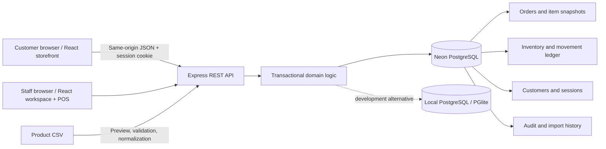
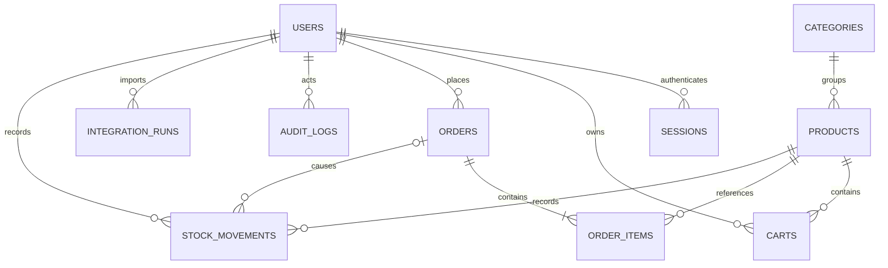

# Architecture

GoShop uses a single backend as the authority for prices, permissions, orders and inventory. React never receives the database URL. Local development and Neon use the same PostgreSQL schema and parameterized SQL.



## Database relationships



The physical schema is in `server/schema.sql`; the SRS contains field definitions and constraints.

## Checkout transaction

```mermaid
sequenceDiagram
  participant B as Browser
  participant A as API
  participant D as PostgreSQL
  B->>A: POST /api/checkout + idempotency key
  A->>D: BEGIN; lock actor row
  A->>D: Find existing order for actor/key
  alt Existing order
    D-->>A: Existing order and items
  else New order
    A->>D: Read persisted cart (online) or validated POS items
    A->>D: Lock products in stable ID order
    A->>A: Check stock; calculate actual prices and shipping
    A->>D: Insert order + item snapshots
    A->>D: Deduct stock; insert movement and audit rows
    A->>D: Clear online cart
  end
  A->>D: COMMIT
  A-->>B: Order details
```

Failures roll back all transaction writes. Unique actor/idempotency keys plus an actor row lock prevent duplicate checkout. Product row locks and guarded stock updates prevent overselling across actors and channels. The cart does not reserve stock.

## Integration and governance

The CSV path represents a small ETL workflow: extract uploaded text, parse rows, normalize SKUs, validate prices/quantities, then load all rows transactionally. Import stock is an absolute count. Existing SKUs are reconciled rather than duplicated. A settings-row lock serializes imports, followed by ordered product locks; the import writes stock deltas, an import-history record and an audit event.

POS and online channels are native GoShop modules connected through one API/database. There is no external POS connector, CDC process or third-party courier connection. Screens poll every 15 seconds and refresh after writes.

## Security boundaries

- Passwords use bcrypt. Session tokens are random 256-bit values; only SHA-256 hashes persist in the database.
- Cookies are HttpOnly and SameSite=Lax, and Secure in production. Server-side sessions expire after seven days.
- API middleware checks authentication and role. Public registration always creates a customer.
- Writes reject foreign browser origins. SQL values use parameters. JSON and CSV sizes are bounded.
- Product image paths are constrained to bundled image paths or HTTPS URLs. React escapes displayed text.
- Helmet provides response hardening and a production content security policy. No connection secrets appear in API responses.
- Exported CSV cells beginning with formula characters are prefixed with an apostrophe.
- Audit records are application append-only; a privileged database owner can still modify them. No tamper-proof logging claim is made.

## Deployment and operations

`npm run build` produces static frontend assets. `npm start` serves those assets and the API from one origin. Production requires PostgreSQL, private environment variables, HTTPS and a bootstrapped administrator. Only an operator who knows the reverse-proxy topology should enable `TRUST_PROXY=1`.

The filesystem-backed local engine supports one application process. Do not run a separate migration/seed process against the directory while development is running. Test databases are in-memory and isolated from local/Neon data.

The baseline migration is idempotent and records version 1. Future schema changes should add numbered migration files and explicit upgrade logic rather than editing deployed tables implicitly. Managed backups, retention, monitoring and real load tests are deployment responsibilities.
